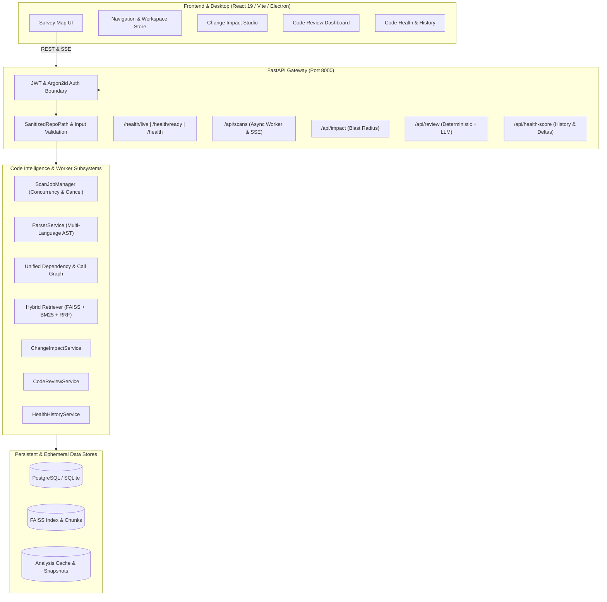
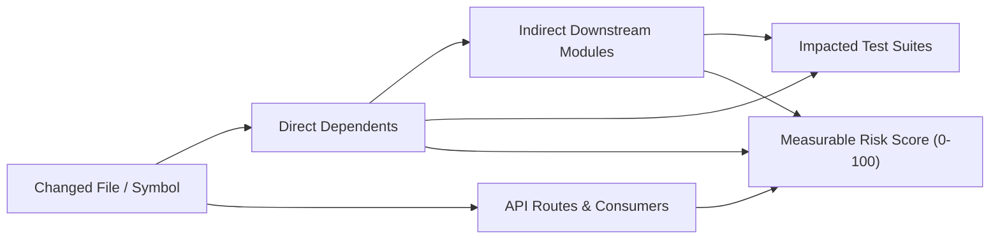

# Architecture Specification — Release V2.1

## 1. System Overview

**Repository Scanner Engine V2.1** is a high-performance, production-oriented repository intelligence platform. It provides structural AST analysis, unified dependency graphs, hybrid vector retrieval, explainable code health scoring, automated code review, and change impact blast-radius analysis.

---

## 2. Multi-Language AST Parsing Pipeline

The parser subsystem routes files by extension to specialized, resilient language parsers:

| Language | File Extensions | Parser Implementation | Extracted Entities |
| :--- | :--- | :--- | :--- |
| **Python** | `.py` | `PythonParser` | Classes, functions, decorators, async def, calls, imports |
| **TypeScript / JS** | `.ts`, `.tsx`, `.js`, `.jsx` | `TypeScriptParser` | Classes, interfaces, functions, arrow functions, ES imports |
| **Java** | `.java` | `JavaParser` | Classes, interfaces, records, methods, Javadoc, package imports |
| **Go** | `.go` | `GoParser` | Structs, interfaces, receiver methods, functions, package imports |
| **Rust** | `.rs` | `RustParser` | Structs, enums, traits, impl blocks, functions, use imports |
| **C / C++** | `.c`, `.cpp`, `.h`, `.hpp` | `CppParser` | Classes, structs, functions, preprocessor includes |
| **C#** | `.cs` | `CSharpParser` | Classes, interfaces, records, methods, using directives |

All extracted structures conform to unified Pydantic models: `ParsedFile`, `ClassInfo`, `FunctionInfo`, and `ImportInfo`.

---

## 3. Asynchronous Worker Architecture (`ScanJobManager`)

To prevent blocking API threads during large repository scans, scans execute asynchronously managed by `ScanJobManager`:

1. **Job Creation & Deduplication**:
   - `POST /api/scans` creates a scan job with a unique UUID.
   - If an active scan is already running for the target repository, the manager returns the existing job ID rather than spawning duplicate work.
2. **Progress & Event Streaming**:
   - Updates progress percentage (0–100%) and stage descriptions (`discovering`, `parsing`, `indexing`, `analyzing`).
   - Clients stream real-time events via `GET /api/scans/{scan_id}/events` using Server-Sent Events (`event: progress`, `event: done`).
3. **Cooperative Cancellation**:
   - `POST /api/scans/{scan_id}/cancel` sets an abort event and cancels the background asyncio task, immediately releasing resources.
4. **Temporary Workspace Cleanup**:
   - Cloned remote repositories are stored in isolated scratch directories and guaranteed to be purged upon job completion or cancellation.

---

## 4. Change Impact Analysis Engine

The Change Impact engine maps how code modifications ripple across the codebase:

### Risk Calculation Formula
Risk scores are deterministic and explainable:
- **Base Score**: 10 points.
- **Direct Dependents**: +12 points each (capped at 36).
- **Indirect Dependents**: +4 points each (capped at 24).
- **Public API Consumers**: +20 points (high risk of breaking external clients).
- **Auth / Security Critical Modules**: +25 points (paths matching `auth`, `security`, `crypto`).
- **Missing Test Coverage Penalty**: +15 points if 0 test files cover the affected area.

---

## 5. Automated AI & Deterministic Code Review

The code review module combines deterministic static rules with optional LLM reasoning:

1. **Git Diff Ingestion**: Parses standard unified diff hunks, extracting changed files, line numbers, and added/removed content.
2. **Deterministic Security Checks**:
   - SQL Injection patterns (unparameterized query construction).
   - Arbitrary command/shell execution (`os.system`, `shell=True`).
   - Weak cryptography (MD5, SHA1 for hashing).
   - Hardcoded secrets and bearer tokens.
   - Event loop blocking sleep (`time.sleep` within `async def`).
   - Bare `except:` clauses swallowing unexpected runtime exceptions.
3. **Test Gap Analysis**: Detects source file modifications made without corresponding test changes.
4. **AI-Assisted Reasoning**: Passes sanitized diffs to the configured LLM provider to evaluate race conditions, edge cases, and API compatibility regressions.

---

## 6. Historical Health Analytics

- Chronological snapshots recorded after each health scan in `HealthHistoryService`.
- Scan-over-scan comparisons calculate score deltas, debt minutes saved, letter grade changes, resolved findings, and degrading modules.
