<div align="center">


<br/>

<a href="https://github.com/Arnav-aka-guy/Repository-scanner-engine/actions/workflows/ci.yml"></a>


<a href="LICENSE"></a>


<br/>


<br/><br/>

<a href="https://github.com/Arnav-aka-guy/Repository-scanner-engine">
  
</a>

<br/><br/>

<a href="#-set-it-up-on-your-computer"><b>Set it up</b></a> &nbsp;&nbsp;
<a href="#-features"><b>Features</b></a> &nbsp;&nbsp;
<a href="#-screenshots"><b>Screenshots</b></a> &nbsp;&nbsp;
<a href="#-what-makes-it-different"><b>Why it's different</b></a> &nbsp;&nbsp;
<a href="#-tests-and-quality"><b>Tests</b></a> &nbsp;&nbsp;
<a href="#-configuration"><b>Config</b></a> &nbsp;&nbsp;
<a href="#-api"><b>API</b></a>

</div>

<br/>

<div align="center">
  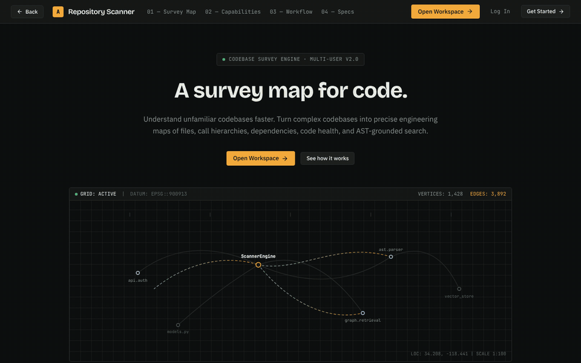
  <br/>
  <sub>A real scan of this repository. Every screen above is the actual app.</sub>
</div>

<br/>

## 💡 Why this exists

Opening an unfamiliar codebase is slow. You click through folders, grep for names, and try to hold the whole thing in your head. Repository Scanner reads the project once and gives you:

- **A map.** Every file, class and function, and how they connect.
- **A search that understands you.** "Where do we check the password?" finds the right function even when those words never appear in it.
- **An assistant you can check.** Every answer cites the exact `file:line` it came from.
- **A health report with the working shown.** Every point lost links to the rule that fired and the files that caused it.
- **A system design diagram,** drawn from the code itself and optionally explained by AI.
- **A one-page report** you can attach to a pull request or send to your team.

It runs on your own computer. Your code is not uploaded anywhere unless you choose a cloud AI provider, and even then only the snippets needed to answer your question are sent.

<div align="center">
  
</div>

<br/>

## ✨ Features

<table>
<tr>
<td width="50%" valign="top">

### 🗂️ My Repositories
Save up to 5 repositories per account, from a folder on your computer or a public GitHub link. Each one keeps its own scan and search index. Rescan pulls new commits from GitHub first. Scans run in the background, can be cancelled, and survive a server restart without getting stuck.

</td>
<td width="50%" valign="top">

### 🧭 Overview
Files, lines, main languages, index status and a five-part quality score on one page. Includes a guided "Understand Repository" walkthrough that tells you where to start reading.

</td>
</tr>
<tr>
<td valign="top">

### 📁 Explorer
A file tree with a syntax-highlighted viewer. A side panel lists every class and function in the open file, with jump, references and Ask AI. **Explain File** gives a plain-English summary of the whole file.

</td>
<td valign="top">

### 🕸️ Dependency graphs
Three views: how files connect, who calls what, and a symbol graph. Folders are grouped so big projects stay readable, and import loops are highlighted.

</td>
</tr>
<tr>
<td valign="top">

### 🏗️ System design diagrams
Draws the project as layers (client, backend, data, external services), with request flows you can click through. Export as PNG, SVG or Mermaid. With a Groq key, AI explains what each part does.

</td>
<td valign="top">

### 🔎 Search by meaning
Hybrid search: embeddings for meaning, keywords for exact names, and the code graph for context. Filter by files, functions, classes, API routes or components.

</td>
</tr>
<tr>
<td valign="top">

### 🤖 Assistant with sources
Ask anything about the code. Answers stream in and cite the files and line ranges they used, so you can check every claim. Works with Groq, OpenAI, OpenRouter or a local Ollama model.

</td>
<td valign="top">

### 🩺 Code health and tech debt
A score out of 100 across complexity, documentation, architecture, maintainability and security. Each deduction shows the rule, the formula and the files behind it.

</td>
</tr>
<tr>
<td valign="top">

### 🧱 Architecture and change impact
Finds layers, entry points and boundary violations. Change Impact shows what could break if you edit a file, which modules depend on it and which tests to run.

</td>
<td valign="top">

### 📝 Docs, code review and reports
Generates an architecture brief, module notes and an onboarding guide. Reviews your uncommitted changes (or the last commit, or a pasted diff) for risky patterns. Downloads a shareable one-page HTML report.

</td>
</tr>
</table>

<details>
<summary><b>🌐 Language support</b></summary>
<br/>

| Level | Languages | What you get |
|---|---|---|
| **Full AST analysis** | Python, TypeScript, JavaScript (`.py` `.ts` `.tsx` `.js` `.jsx` `.mjs` `.cjs`) | Functions, signatures, classes, docstrings, imports (including `@/` aliases), call graph, dead-code hints, nesting depth |
| **Structure extraction** | Java, Go, Rust, C, C++, C# | Imports, classes, structs, interfaces, functions and methods |
| **Search and browsing** | 30+ other extensions (`.sql` `.sh` `.rb` `.php` `.yaml` `.md` and more) | File tree, line counts, code viewer, semantic search |

New languages plug in through the `LanguageParser` protocol in `backend/parser/protocol.py`.

</details>

## 🖼️ Screenshots

All taken from a real scan of this repository (286 files, 64,726 lines).

<table>
<tr>
<td colspan="2" align="center"><b>Overview</b><br/>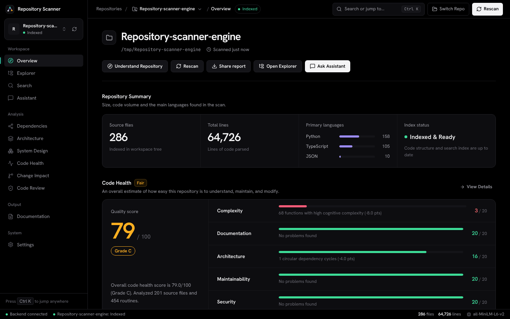</td>
</tr>
<tr>
<td width="50%" align="center"><b>Landing page</b><br/>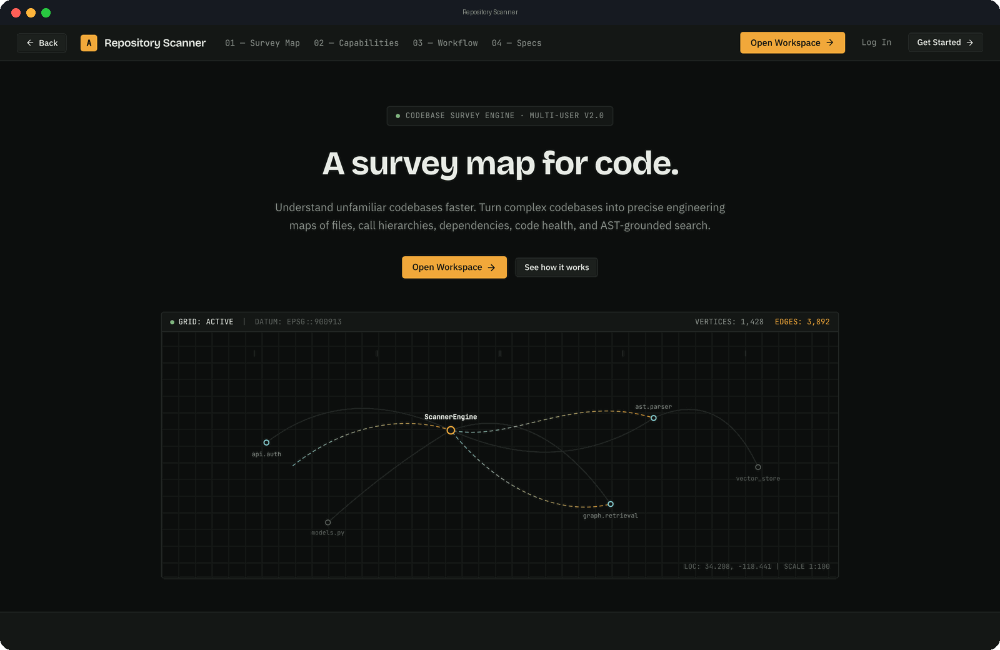</td>
<td width="50%" align="center"><b>My Repositories</b><br/>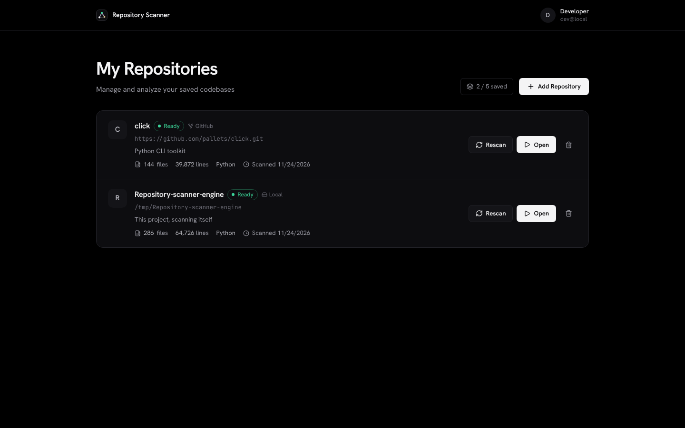</td>
</tr>
<tr>
<td align="center"><b>Explorer</b><br/></td>
<td align="center"><b>System Design</b><br/>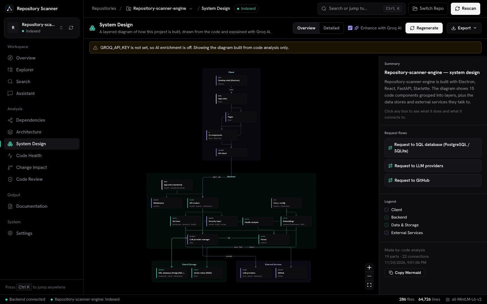</td>
</tr>
<tr>
<td align="center"><b>Dependency graph</b><br/></td>
<td align="center"><b>Architecture</b><br/>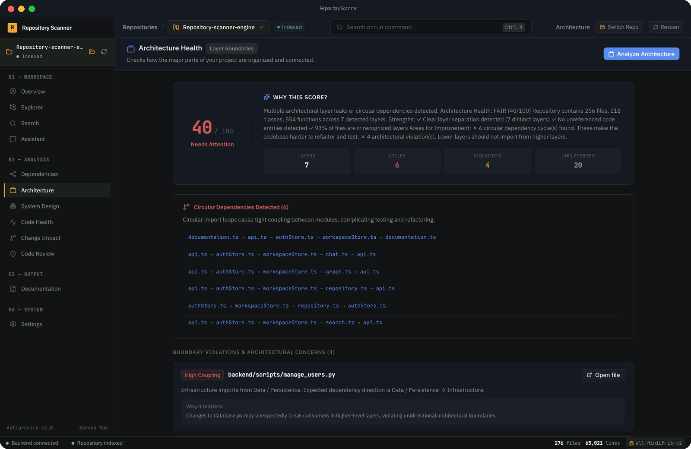</td>
</tr>
<tr>
<td align="center"><b>Code Health</b><br/>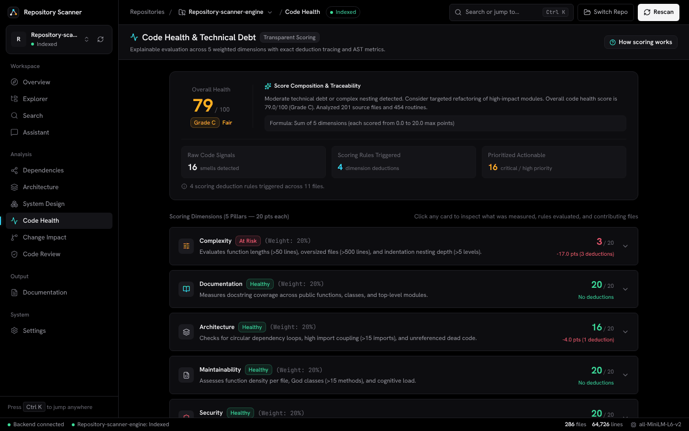</td>
<td align="center"><b>Search by meaning</b><br/></td>
</tr>
<tr>
<td align="center"><b>Command palette (Ctrl K)</b><br/>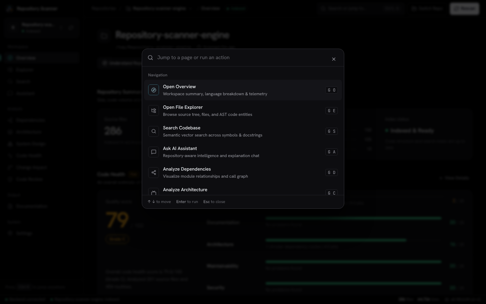</td>
<td align="center"><b>Shareable report</b><br/>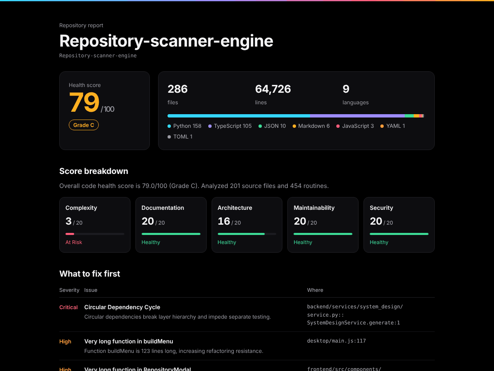</td>
</tr>
</table>

<details>
<summary><b>📱 On a phone</b></summary>
<br/>
<div align="center">
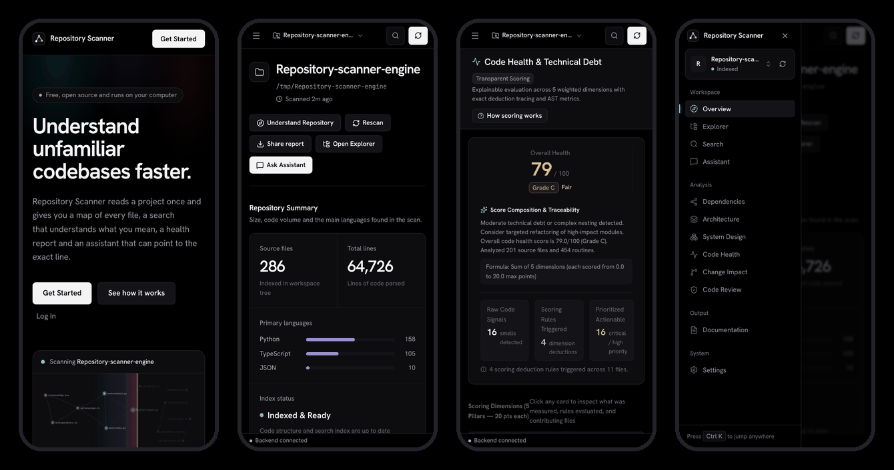
</div>
</details>

<details>
<summary><b>🔐 Login page</b></summary>
<br/>
<div align="center">
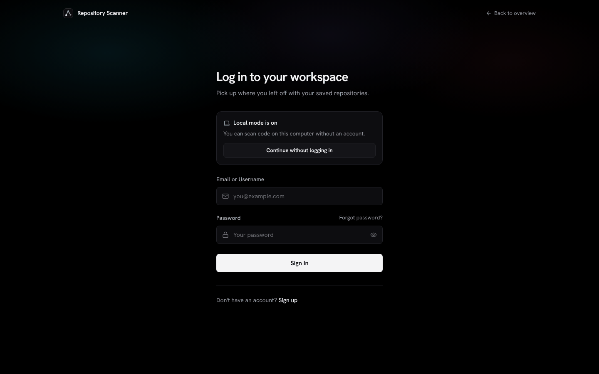
</div>
</details>

## 🧩 What makes it different

Most tools answer one of these questions. This one answers all of them from the same scan, so the answers agree with each other.

| | Editor search | Cloud AI chat | Linters | **Repository Scanner** |
|---|:---:|:---:|:---:|:---:|
| Finds code by exact name | ✅ | ➖ | ➖ | ✅ |
| Finds code by meaning | ➖ | ✅ | ➖ | ✅ |
| Answers cite `file:line` you can check | ➖ | ⚠️ often not | ➖ | ✅ |
| Shows how files and functions connect | ➖ | ➖ | ➖ | ✅ |
| Draws the system design | ➖ | ⚠️ from guesswork | ➖ | ✅ from the code |
| Scores code health with the working shown | ➖ | ➖ | ⚠️ rule hits only | ✅ |
| Tells you what breaks if you change a file | ➖ | ➖ | ➖ | ✅ |
| Works fully offline | ✅ | ➖ | ✅ | ✅ with Ollama |
| Your code stays on your computer | ✅ | ➖ | ✅ | ✅ |

**Built to be trusted:**

- **Grounded answers.** The assistant only gets the retrieved code as context and must cite it, so you can check every claim.
- **Honest scores.** The health score is computed by deterministic rules, not by AI. The same code always gets the same score.
- **Safe with untrusted repos.** Files and symlinks that point outside the repository are never read. `.env` files and folders like `.ssh` are refused.
- **Free to run.** The free tiers of Groq or a local Ollama model are enough. Embeddings run on your own CPU.

## 🚀 Set it up on your computer

### What you need

| Tool | Version | Get it from |
|---|---|---|
| **Python** | 3.11 or newer (CI uses 3.13) | [python.org/downloads](https://www.python.org/downloads/). On Windows, tick **"Add python.exe to PATH"** during install. |
| **Node.js** | 20.19 or newer (22 recommended) | [nodejs.org](https://nodejs.org/) (pick the LTS version) |
| **Git** | any recent version | [git-scm.com/downloads](https://git-scm.com/downloads) |
| **An AI model** | at least one, see step 4 | Groq (free key) or Ollama (fully offline) |

Check them in a terminal:

```bash
python --version     # Windows may need: py --version
node --version
git --version
```

### Step 1: Download the code

```bash
git clone https://github.com/Arnav-aka-guy/Repository-scanner-engine.git
cd Repository-scanner-engine
```

### Step 2: Install the backend

```bash
python -m venv venv
```

Turn the virtual environment on. You need to do this in every new terminal.

```bash
# Windows (PowerShell)
.\venv\Scripts\Activate.ps1
# Windows (Command Prompt)
venv\Scripts\activate.bat
# macOS / Linux
source venv/bin/activate
```

Then install the packages (this takes a few minutes the first time):

```bash
pip install -r backend/requirements.txt
```

> [!TIP]
> If PowerShell says running scripts is disabled, run `Set-ExecutionPolicy -Scope CurrentUser RemoteSigned` once and try again.

### Step 3: Create your settings file

```bash
# Windows
copy .env.example .env
# macOS / Linux
cp .env.example .env
```

Open `.env` in any text editor and set **which folders the app may scan**. Anything outside these folders is refused, which keeps the rest of your disk safe.

```env
# One or more folders, separated by commas
ALLOWED_ROOTS=C:/Users/you/projects          # Windows example
# ALLOWED_ROOTS=/home/you/projects            # macOS / Linux example
```

### Step 4: Pick an AI model

The map, graphs, health score, search and reports work **without any AI**. You only need a model for the assistant, AI explanations in System Design, and AI-written docs. Pick one option, or several (the app tries them in the order Groq → OpenAI → OpenRouter → Ollama).

<details open>
<summary><b>Option A: Groq (free, fastest, recommended)</b></summary>
<br/>

1. Go to [console.groq.com](https://console.groq.com) and sign in with Google or GitHub. No credit card needed.
2. Open **API Keys** ([console.groq.com/keys](https://console.groq.com/keys)) and click **Create API Key**.
3. Copy the key (it starts with `gsk_`). You only see it once.
4. Paste it into `.env`:

```env
GROQ_API_KEY=gsk_your_key_here
GROQ_MODEL=llama-3.3-70b-versatile          # used by the assistant
SYSTEM_DESIGN_MODEL=openai/gpt-oss-120b     # used for system design diagrams
```

Free accounts have rate limits. If you hit them, the System Design page falls back to OpenRouter (Option C) or to the diagram drawn from code analysis alone.

</details>

<details>
<summary><b>Option B: Ollama (completely offline, no account)</b></summary>
<br/>

1. Install Ollama from [ollama.com/download](https://ollama.com/download) (Windows, macOS and Linux).
2. Download a model. `llama3` matches the default setting:

```bash
ollama pull llama3
```

   Smaller computer? Try a lighter model from [ollama.com/library](https://ollama.com/library), for example `ollama pull llama3.2`, and set `LLM_MODEL=llama3.2`.

3. Make sure Ollama is running (it starts on its own after install; otherwise run `ollama serve`).
4. The defaults in `.env` already point at it:

```env
LLM_PROVIDER=auto              # or "ollama" to always use it
LLM_MODEL=llama3
LLM_BASE_URL=http://localhost:11434
```

Nothing leaves your computer with this option. Answers are slower than Groq and depend on your hardware.

</details>

<details>
<summary><b>Option C: OpenRouter (many models, some free)</b></summary>
<br/>

1. Sign up at [openrouter.ai](https://openrouter.ai) and create a key at [openrouter.ai/keys](https://openrouter.ai/keys). Some accounts are asked for billing details first; if that happens, use Groq or Ollama instead.
2. Add it to `.env`. Models ending in `:free` cost nothing but have daily limits.

```env
OPENROUTER_API_KEY=sk-or-your_key_here
OPENROUTER_MODEL=meta-llama/llama-3.3-70b-instruct
SYSTEM_DESIGN_FALLBACK_MODEL=openai/gpt-oss-120b:free
```

</details>

<details>
<summary><b>Option D: OpenAI or any OpenAI-compatible server</b></summary>
<br/>

```env
OPENAI_API_KEY=sk-your_key_here
OPENAI_BASE_URL=https://api.openai.com/v1     # or the URL of LM Studio, vLLM, etc.
```

</details>

> [!NOTE]
> **The search model downloads itself.** The first scan downloads the small embedding model `all-MiniLM-L6-v2` (about 90 MB) from Hugging Face and caches it. After that, search works offline. You can change it with `EMBEDDING_MODEL` in `.env`.

> [!IMPORTANT]
> Never commit your `.env` file. It is already in `.gitignore`. If a key ever leaks (for example in a screenshot), delete it in the provider's dashboard and create a new one.

### Step 5: Install the frontend

```bash
npm install
cd frontend
npm install
cd ..
```

### Step 6: Start it

```bash
npm run dev
```

This starts both the backend and the frontend. Then open **http://localhost:5173**.

| What | Address |
|---|---|
| The app | http://localhost:5173 |
| Backend API | http://127.0.0.1:8000 |
| Interactive API docs | http://127.0.0.1:8000/api/docs |

### Step 7: Scan your first repository

1. Click **Get Started** (in local mode there is no login).
2. Click **Add Repository**.
3. Choose **Local Directory** and click **Browse** (or paste the folder path), or choose **Public GitHub** and paste a link like `https://github.com/pallets/click`.
4. Click **Scan** on the new card if it has not started already. Most projects finish in under a minute.
5. Click **Open** and start with **Understand Repository** on the Overview page.

<details>
<summary><b>🛠️ Something not working?</b></summary>
<br/>

| Problem | Fix |
|---|---|
| `python` is not recognised (Windows) | Use `py` instead of `python`, or reinstall Python with **"Add to PATH"** ticked. |
| `npm run dev` says `py -3.13` not found | Start the two parts by hand: `python -m uvicorn backend.main:app --reload --port 8000` in one terminal, and `cd frontend && npm run dev` in another. |
| "Path not allowed" when adding a folder | Add that folder (or a parent folder) to `ALLOWED_ROOTS` in `.env` and restart the backend. |
| The assistant says no AI provider is configured | Add a key from step 4, or start Ollama, then restart the backend. Check **Settings → Test Connection**. |
| Groq says "rate limit" or "429" | Wait a minute, or add an OpenRouter key as a fallback. |
| First scan is slow | The first scan downloads the embedding model (about 90 MB). Later scans are much faster and only re-read changed files. |
| Port 8000 or 5173 is busy | Close the other program, or change the port in the command. |

</details>

<details>
<summary><b>🖥️ Desktop app (Electron)</b></summary>
<br/>

```bash
cd desktop
npm install
cd ..
npm run dev:desktop
```

The desktop window starts the backend on `127.0.0.1` for you.

</details>

<details>
<summary><b>📦 Single-server mode (FastAPI serves the built frontend)</b></summary>
<br/>

```bash
cd frontend && npm run build && cd ..
python -m uvicorn backend.main:app --host 127.0.0.1 --port 8000
```

Everything is then on http://127.0.0.1:8000.

</details>

<details>
<summary><b>🐳 Docker</b></summary>
<br/>

```bash
docker compose up --build
```

Put the repositories you want to scan in `./repos`. Inside the container they appear under `/repos/...`. The port is published on `127.0.0.1` only.

</details>

## 🧪 Tests and quality

Checked on **24 November 2026** against commit `333432f` on `main`:

| Check | Command | Result |
|---|---|---|
| Backend tests | `pytest` | ✅ **311 passed**, 8 skipped (platform-specific), 32 test files, about 18 s |
| Backend coverage | `pytest --cov=backend` | 📊 **71%** of 10,148 statements |
| Frontend tests | `cd frontend && npx vitest run` | ✅ **108 passed** in 26 files |
| Lint and format | `ruff check backend tests` and `ruff format --check` | ✅ no issues |
| Python types | `mypy backend/ --ignore-missing-imports` | ✅ no issues in 120 files |
| TypeScript types | `cd frontend && npx tsc -b` | ✅ no errors |
| Production build | `cd frontend && npm run build` | ✅ builds in about 1 s |

GitHub Actions runs the same checks on every push ([see CI](.github/workflows/ci.yml)).

**What the tests cover:**

- **Security.** Path traversal, symlink escapes (including symlinked files that point outside a repo), blocked system folders, per-user isolation, rate limits, weak JWT secrets and redacted errors.
- **Scanning.** Scan limits, one scan per repository at a time, real cancellation, recovery after a restart, GitHub rescans and incremental re-indexing.
- **Analysis.** Parsers for every supported language, graphs, import-loop detection, health scoring, tech debt, change impact and code review diff selection.
- **AI.** Provider fallback, rate limits and the daily AI allowance, with mock providers so tests never call a paid API.
- **Frontend.** Navigation, page rendering, scan workflows, the repository limit, auth screens, design tokens and service calls.

Run everything yourself:

```bash
pytest                                  # backend
ruff check backend tests                # lint
cd frontend && npx vitest run           # frontend
```

Tests use a lightweight mock embedding model by default, so they run in seconds without downloading anything.

## 🏛️ How it is built

| Layer | What it uses |
|---|---|
| **Frontend** | React 19, Vite, TypeScript, Tailwind CSS v4, Zustand, React Router 7, React Flow with dagre layout, Radix UI, Framer Motion |
| **Backend** | FastAPI, async SQLAlchemy (SQLite by default, PostgreSQL supported), Alembic migrations, SlowAPI rate limits |
| **Analysis** | Python `ast`, parsers for TypeScript and JavaScript, structure extractors for Java, Go, Rust, C, C++ and C#, NetworkX graphs |
| **Search** | sentence-transformers embeddings, FAISS vector index, BM25 keyword index, graph-aware reranking |
| **AI** | Groq, OpenAI-compatible, OpenRouter and Ollama providers with automatic fallback |
| **Desktop** | Electron shell around the same app |

<details>
<summary><b>🗂️ Project structure</b></summary>
<br/>

```text
Repository-scanner-engine/
├── backend/
│   ├── api/              # FastAPI routers (repositories, graph, search, chat, report, …)
│   ├── parser/           # Language parsers, scanner, change manifests
│   ├── graph/            # Dependency, call and symbol graphs, architecture analysis
│   ├── embeddings/       # Encoder, FAISS store, BM25 keyword index, reranker
│   ├── retrieval/        # Vector, graph and hybrid retrievers
│   ├── llm/              # Groq, OpenAI-compatible, OpenRouter and Ollama providers
│   ├── services/         # Scan worker, health, tech debt, impact, review, system design, report, mailer
│   ├── security/         # Auth, path checks, repository access, rate limits, AI allowance
│   ├── db/               # SQLAlchemy models and sessions
│   └── main.py           # App entry point
├── frontend/             # React 19 + Vite + TypeScript app
├── desktop/              # Electron shell
├── tests/                # Backend tests (pytest)
├── alembic/              # Database migrations
├── docs/                 # Extra docs and README images
├── scripts/              # Helper scripts
├── Dockerfile
└── docker-compose.yml
```

See [ARCHITECTURE.md](ARCHITECTURE.md) for how the pieces talk to each other.

</details>

## ⚙️ Configuration

All settings live in `.env`. The full list with comments is in [`.env.example`](.env.example). For your own computer you only need `ALLOWED_ROOTS` and one AI option.

| Setting | Default | What it does |
|---|---|---|
| `ALLOWED_ROOTS` | `~/projects` | Folders that may be scanned (comma-separated). Everything else is refused. |
| `LLM_PROVIDER` | `auto` | Uses the first provider that has a key, otherwise Ollama |
| `GROQ_API_KEY` / `GROQ_MODEL` | – / `llama-3.3-70b-versatile` | Groq key and assistant model |
| `SYSTEM_DESIGN_MODEL` | `openai/gpt-oss-120b` | Groq model used only for system design diagrams |
| `OPENROUTER_API_KEY` | – | Optional fallback for diagrams and chat |
| `OPENAI_API_KEY` / `OPENAI_BASE_URL` | – | OpenAI or any OpenAI-compatible server |
| `LLM_BASE_URL` / `LLM_MODEL` | `http://localhost:11434` / `llama3` | Ollama, for fully offline use |
| `EMBEDDING_MODEL` | `all-MiniLM-L6-v2` | Search model (downloads once, runs on your CPU) |
| `MAX_FILES` / `MAX_FILE_SIZE_BYTES` / `MAX_DIRECTORY_DEPTH` | `10000` / 5 MB / `30` | Scan limits |
| `DATA_DIR` | `data` | Where indexes, caches and the SQLite database live |
| `AUTH_ENABLED` / `JWT_SECRET_KEY` | `false` / – | Multi-user login. A weak or placeholder secret stops the server from starting. |
| `AI_DAILY_LIMIT_PER_USER` | `0` (no cap) | When hosting for others, caps AI requests per user per day |
| `SMTP_HOST` and other `SMTP_*` | empty (off) | Sends password reset emails (a Gmail app password works) |
| `PUBLIC_APP_URL` | `http://localhost:8000` | Address used in reset links |

<details>
<summary><b>👥 Hosting it for other people</b></summary>
<br/>

1. Generate a strong secret: `python -c "import secrets; print(secrets.token_hex(32))"`
2. Set these in `.env`:

```env
AUTH_ENABLED=true
APP_MODE=cloud
JWT_SECRET_KEY=<the secret from step 1>
AI_DAILY_LIMIT_PER_USER=30        # protects your free AI quota
PUBLIC_APP_URL=https://your-domain.example
```

3. Optional: set the `SMTP_*` settings so "Forgot password" can send emails. Without them, an admin can reset passwords with `python -m backend.scripts.manage_users`.

With login on, every repository, index and chat history belongs to one user, and the folder picker is turned off because it would open on the server. See [`docs/USER_MANAGEMENT.md`](docs/USER_MANAGEMENT.md).

</details>

## 📡 API

Interactive docs are at **`/api/docs`** once the server is running. Repository routes accept `repository_id` (preferred) or `repo_path`, and always check that the repository belongs to the current user.

<details>
<summary><b>See all endpoints</b></summary>
<br/>

| Area | Endpoints |
|---|---|
| **Auth** | `POST /api/auth/register`, `/login`, `/refresh`, `/logout`, `/forgot-password`, `/reset-password`; `GET /api/auth/me`, `/status` |
| **Repositories** | `GET, POST /api/repositories`; `GET, PATCH, DELETE /api/repositories/{id}`; `POST /api/repositories/{id}/scan` |
| **Scan jobs** | `POST /api/repository/scan/async`; `GET /api/repository/scan/jobs/{job_id}`; `GET .../events` (live progress); `POST .../cancel` |
| **Files** | `GET /api/repository/files`, `/file/{path}`, `/onboarding` |
| **Graphs** | `GET /api/graph/dependency`, `/call`, `/symbol`, `/analysis`, `/impact` |
| **System design** | `POST /api/system-design/generate`; `GET /api/system-design` |
| **Search and chat** | `POST /api/search`; `POST /api/chat` (streaming); `GET /api/chat/history`, `/conversations` |
| **Insights** | `GET /api/health-score`, `/history`, `/compare`; `GET /api/tech-debt`; `GET /api/dependency-risk` |
| **Architecture and changes** | `POST /api/architecture/report`; `GET /api/architecture/layers`; `POST /api/impact/analyze`; `POST /api/review/analyze` |
| **Docs and reports** | `POST /api/documentation/generate`; `GET /api/documentation/export`; `GET /api/report` (HTML download) |
| **Settings and health** | `GET /api/settings/providers`, `/ai-health`; `GET /livez`, `/readyz` |

</details>

## 🛡️ Security

This app reads source code from your disk, so it is careful about it:

- **Local by default.** The server listens on `127.0.0.1` only.
- **Path containment.** Every path is resolved and checked against the repository root. `../` tricks, symlinks pointing outside the repo, system folders and sensitive folders such as `.ssh` and `.aws` are refused.
- **Per-user isolation.** With login on, other users get `404` for your repositories.
- **Proper auth.** bcrypt password hashing, short-lived access tokens with refresh, logout revokes tokens, and the server refuses to start with a weak secret.
- **Limits everywhere.** Rate limits on login, scans, search, chat and AI features, plus scan size limits and an optional daily AI allowance.
- **Clean errors.** API keys are redacted from anything sent back to the browser.

Found a problem? See [SECURITY.md](SECURITY.md).

## 🗺️ Roadmap

- [x] Multi-user accounts with per-user repositories
- [x] Structure extraction for Java, Go, Rust, C, C++ and C#
- [x] System design diagrams with PNG, SVG and Mermaid export
- [x] Shareable one-page HTML reports
- [x] Real scan cancellation and recovery after restarts
- [ ] Private GitHub repositories with a personal access token
- [ ] GitHub App that posts the report on every pull request
- [ ] Database (ER) diagrams from SQLAlchemy and Prisma models
- [ ] Sequence diagrams from request flows
- [ ] Editable system design diagrams that keep your changes

## 🤝 Contributing

Contributions are welcome.

1. Fork the repo and create a branch: `git checkout -b feat/your-idea`
2. Make your change and add tests
3. Check that `pytest`, `ruff check backend tests` and `cd frontend && npx vitest run` pass
4. Open a pull request that explains what changed and why

## 📄 License

Released under the [MIT License](LICENSE). Free to use, change and share.

<div align="center">
<br/>

**If this project helped you, give it a ⭐ so others can find it.**

Made by [Arnav Chaudhary](https://github.com/Arnav-aka-guy)


</div>
