<div align="center">


<br/>

<a href="https://github.com/Arnav-aka-guy/Repository-scanner-engine/actions/workflows/ci.yml"></a>

<a href="LICENSE"></a>


<h3>Point it at any codebase. Get a map you can actually read.</h3>

<p>
Repository Scanner Engine parses a project, builds graphs of how its files, classes and functions connect,<br/>
indexes everything for search, and lets you ask questions in plain English with answers that cite <code>file:line</code>.<br/>
It can also draw the whole project as a <b>system design diagram</b>, with Groq AI explaining each part.
</p>

<a href="#quick-start"><b>Quick start</b></a> ·
<a href="#features"><b>Features</b></a> ·
<a href="#system-design-diagrams"><b>System design</b></a> ·
<a href="#architecture"><b>Architecture</b></a> ·
<a href="#configuration"><b>Configuration</b></a> ·
<a href="#api-reference"><b>API</b></a> ·
<a href="#security"><b>Security</b></a>

<br/><br/>


<sub>The app scanning its own source code: 276 files, 65,021 lines.</sub>

</div>

<br/>

## 💡 Why this exists

Joining a new codebase usually means hours of clicking through folders and guessing how things fit together. This tool does that groundwork for you:

- **See the shape** of a project at a glance: layers, folders, imports, call chains and cycles.
- **Find things by meaning**, not just by exact text.
- **Ask questions** and get answers grounded in the real code, with the files and line numbers they came from.
- **Know where it hurts**: a health score with the exact rules behind every point lost.
- **Explain it to others**: export a clean system design diagram for a report, a review or an exam.

It runs as a web app, as a desktop app (Electron) or in Docker. It works with cloud LLMs (Groq, OpenAI, OpenRouter) or fully offline with Ollama.

## 🔄 How it works

<div align="center">

</div>

1. **Scan.** Add a local folder or paste a public GitHub URL (cloned with `--depth 1` into a sandboxed temp folder).
2. **Parse.** Each file is parsed into imports, classes, functions, signatures and docstrings.
3. **Graph.** The results become a dependency graph, a call graph and a symbol graph (NetworkX).
4. **Index.** Code chunks are embedded with Sentence Transformers into FAISS and also indexed for BM25 keyword search.
5. **Understand.** Everything else (search, chat, health, impact analysis, docs and system design) is built on top of these.

Rescans are incremental. A SHA-256 manifest records every file, so only changed files are parsed and embedded again.

<a id="features"></a>

## ✨ Features

<table>
<tr>
<td width="50%" valign="top">

### 📁 My Repositories
Save local folders and GitHub repos, scan them in the background with live progress, and rescan or delete them later. With login turned on, every user only sees their own repositories.

</td>
<td width="50%" valign="top">

### 🧭 Overview
Files, lines, languages and a health summary on one page, plus a guided walkthrough of where to start reading.

</td>
</tr>
<tr>
<td width="50%" valign="top">

### 🗂️ Explorer
A file tree with a syntax-highlighted code viewer and a panel listing every function and class in the open file.

</td>
<td width="50%" valign="top">

### 🕸️ Dependency graph
Three views: how files connect, who calls what, and a symbol graph. Big graphs start grouped by folder, so they stay readable and fast. Filters cover high connectivity, circular dependencies and direct neighbours.

</td>
</tr>
<tr>
<td width="50%" valign="top">

### 🏗️ System design diagrams
A layered diagram (Client → Backend → Data & External services) built from the code and explained by Groq AI. Request flows highlight step by step. Export to PNG, SVG, Mermaid or JSON. [More below ↓](#system-design-diagrams)

</td>
<td width="50%" valign="top">

### 🔎 Hybrid search
Semantic search (FAISS) and keyword search (BM25), merged with Reciprocal Rank Fusion. Results show the file, the symbol and why it matched.

</td>
</tr>
<tr>
<td width="50%" valign="top">

### 🤖 Grounded AI assistant
Ask about the code in plain English. A Graph-RAG retriever collects the right code chunks plus their graph neighbours, and the answer streams back with `Sources (file:lines)`.

</td>
<td width="50%" valign="top">

### 🩺 Code health & tech debt
A score out of 100 across five areas (documentation, complexity, architecture, maintainability and security). Every lost point links to the rule and the files behind it. Health history lets you compare scans.

</td>
</tr>
<tr>
<td width="50%" valign="top">

### 🧱 Architecture & change impact
Detects layers and layer violations, circular dependencies and coupling. Change impact shows what breaks if you edit a file: affected modules, API routes and tests.

</td>
<td width="50%" valign="top">

### 📝 Docs & code review
Generates onboarding docs (Markdown export) and reviews a diff or patch for risky changes.

</td>
</tr>
</table>

## 🖼️ Screenshots

<table>
<tr>
<td width="50%"><p align="center"><sub><b>Landing page</b></sub></p></td>
<td width="50%">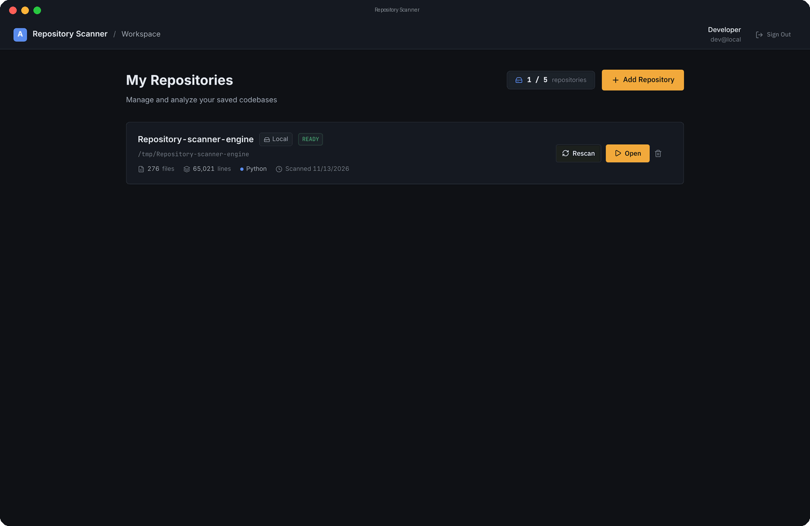<p align="center"><sub><b>My Repositories</b></sub></p></td>
</tr>
<tr>
<td width="50%"><p align="center"><sub><b>Overview: size, languages and health at a glance</b></sub></p></td>
<td width="50%">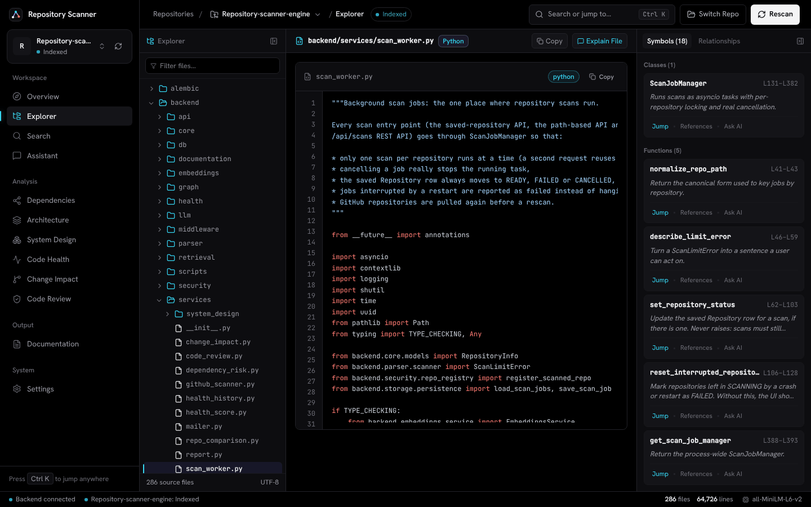<p align="center"><sub><b>Explorer with symbols panel</b></sub></p></td>
</tr>
<tr>
<td width="50%">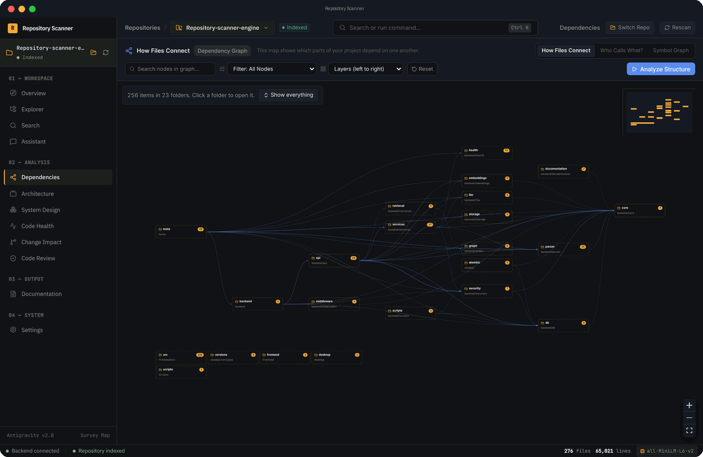<p align="center"><sub><b>Dependency graph, grouped by folder</b></sub></p></td>
<td width="50%">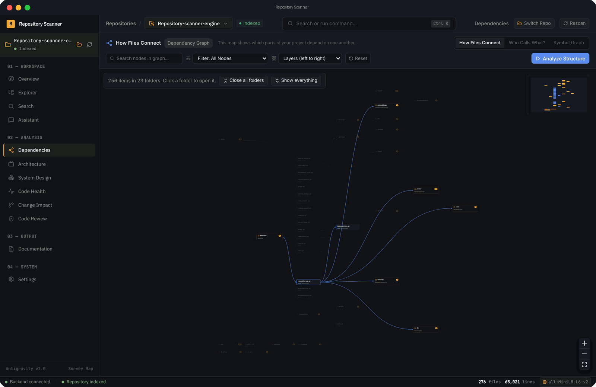<p align="center"><sub><b>Open a folder and hover a file to trace it</b></sub></p></td>
</tr>
<tr>
<td width="50%">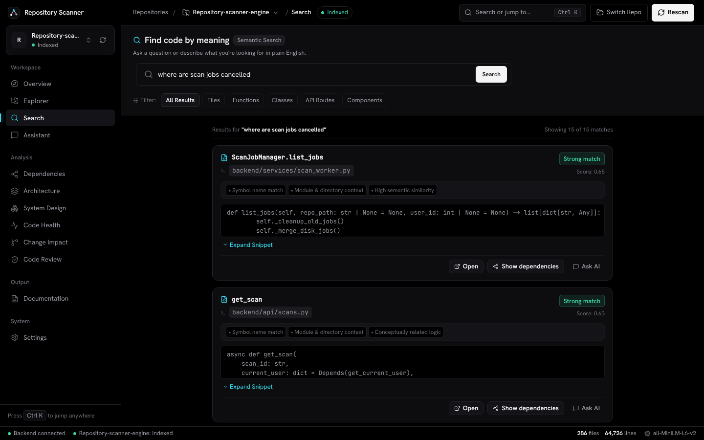<p align="center"><sub><b>Hybrid search</b></sub></p></td>
<td width="50%"><p align="center"><sub><b>Code health with traceable penalties</b></sub></p></td>
</tr>
<tr>
<td width="50%"><p align="center"><sub><b>Architecture: layers and violations</b></sub></p></td>
<td width="50%">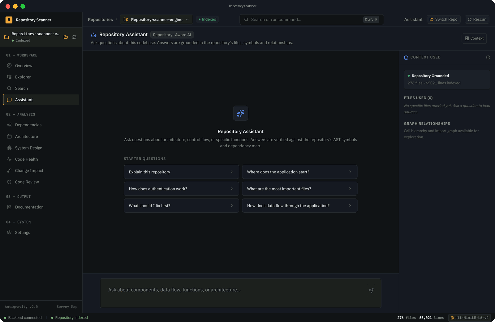<p align="center"><sub><b>AI assistant with starter questions</b></sub></p></td>
</tr>
</table>

<a id="system-design-diagrams"></a>

## 🏗️ System design diagrams

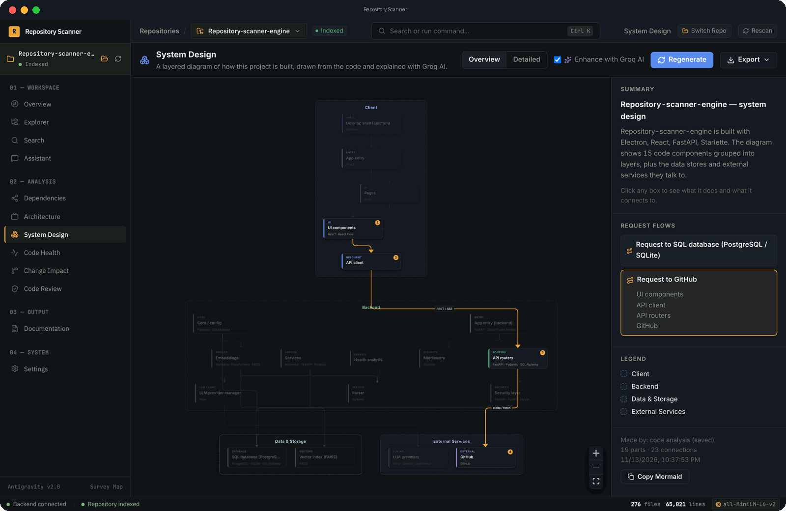

The **System Design** page draws a layered diagram of the open repository, in the style used in textbooks and exams:

| Step | What happens |
|---|---|
| **1. Read the code** | Folders become components. Imports between them become arrows. `requirements.txt`, `package.json`, `docker-compose.yml`, routes and `.env.example` key names reveal the databases, vector stores and outside services. |
| **2. Draft** | A deterministic layout places everything in four layers: **Client**, **Backend**, **Data & Storage** and **External Services**. |
| **3. Explain (optional)** | Groq (`openai/gpt-oss-120b`) gives each part a clear name and description, writes a summary, and adds 2–4 numbered request flows such as *"Ask a question in chat"*. |
| **4. Explore & export** | Click a box to see what it does and what it connects to. Click a flow to light it up step by step. Switch between **Overview** and **Detailed**. Export as **PNG, SVG, Mermaid or JSON**. |

**Stays within free limits.** Requests are kept small enough for Groq's free tier. On a `429` it waits for `retry-after` and tries once more, then falls back to OpenRouter (if configured). If no AI is available, you still get the diagram built from code analysis. Results are cached per repository and only regenerated when the code changes.

**Safe by design.** It never opens `.env` (only the key *names* in `.env.example`), never follows symlinks out of the repository, and checks every AI reply against a strict schema before showing it as plain text.

<a id="architecture"></a>

## 🧩 Architecture

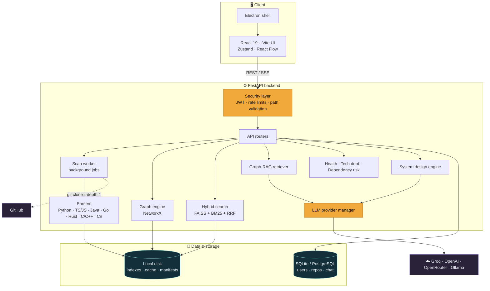

<details>
<summary><b>💬 How a chat question is answered</b></summary>
<br/>

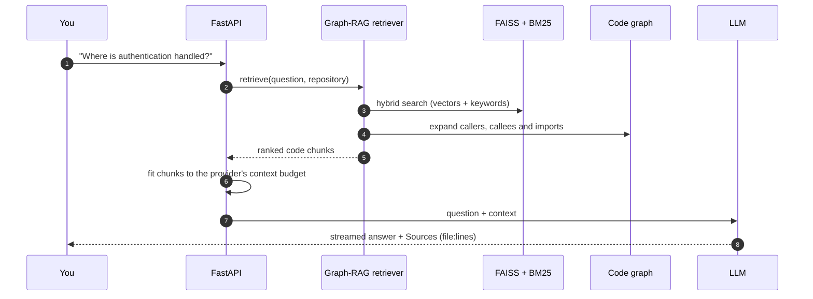

</details>

<details>
<summary><b>🔄 How a scan runs</b></summary>
<br/>

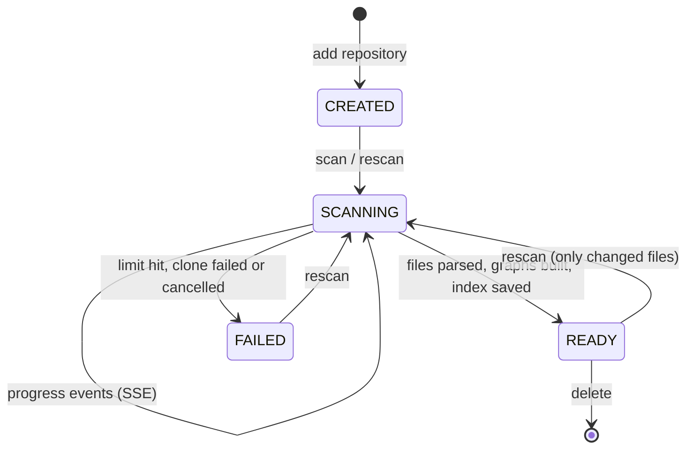

</details>

<details>
<summary><b>🏗️ How a system design diagram is generated</b></summary>
<br/>

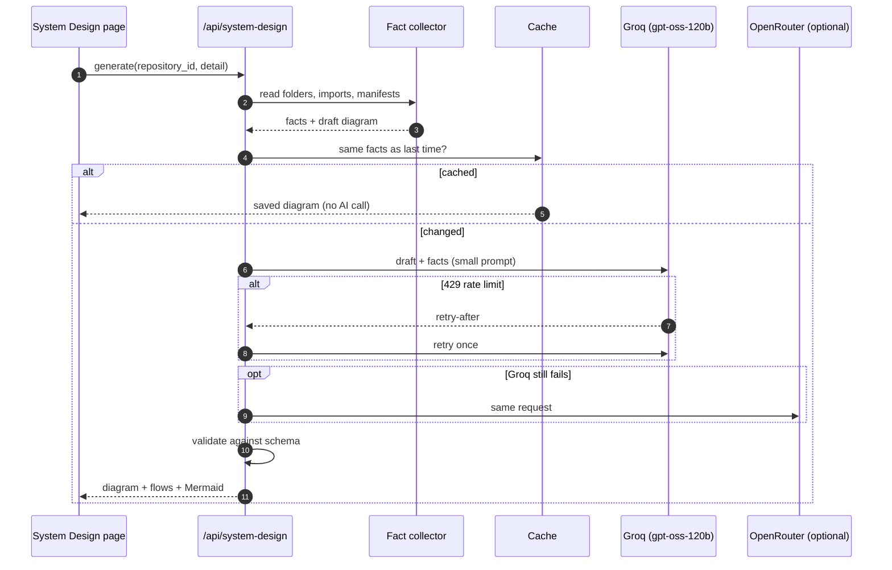

</details>

## 🌐 Language support

| Level | Languages | What you get |
|---|---|---|
| **Full AST analysis** | Python, TypeScript, JavaScript (`.py` `.ts` `.tsx` `.js` `.jsx` `.mjs` `.cjs`) | Functions, signatures, classes, docstrings, imports (including `@/` aliases), call graph, dead-code hints, nesting depth |
| **Structure extraction** | Java, Go, Rust, C, C++, C# | Imports, classes/structs/interfaces, functions and methods |
| **Search & browsing** | 30+ other extensions (`.sql` `.sh` `.rb` `.php` `.yaml` `.md` …) | File tree, line counts, change manifests, code viewer, semantic search |

New languages plug in through the `LanguageParser` protocol in `backend/parser/protocol.py`.

<a id="quick-start"></a>

## 🚀 Quick start

> **You need:** Python 3.11+ (3.13 is what CI uses), Node.js 20.19+ (22 recommended) and Git.

```bash
# 1. Clone
git clone https://github.com/Arnav-aka-guy/Repository-scanner-engine.git
cd Repository-scanner-engine

# 2. Backend
python -m venv venv
source venv/bin/activate            # Windows: .\venv\Scripts\activate
pip install -r backend/requirements.txt

# 3. Config: copy the example and add at least one LLM key (or use Ollama)
cp .env.example .env                # Windows: copy .env.example .env

# 4. Frontend + run both
npm install
cd frontend && npm install && cd ..
npm run dev
```

| What | Where |
|---|---|
| Web app | http://localhost:5173 |
| Backend API | http://127.0.0.1:8000 |
| Interactive API docs | http://127.0.0.1:8000/api/docs |

Then open the app, click **Open Workspace → Add Repository**, choose a folder (or paste a GitHub URL) and wait for the scan to finish.

<details>
<summary><b>🖥️ Desktop app (Electron)</b></summary>
<br/>

```bash
cd desktop && npm install && cd ..
npm run dev:desktop
```

The desktop shell starts the backend on `127.0.0.1` for you.

</details>

<details>
<summary><b>📦 Production mode (FastAPI serves the built frontend)</b></summary>
<br/>

```bash
cd frontend && npm run build && cd ..
python -m uvicorn backend.main:app --host 127.0.0.1 --port 8000
```

Everything is then on http://127.0.0.1:8000, including the client-side routes.

</details>

<details>
<summary><b>🐳 Docker</b></summary>
<br/>

```bash
docker compose up --build
```

Put the repositories you want to scan in `./repos`. Inside the container they appear under `/repos/...`. The port is published on `127.0.0.1` only.

</details>

<a id="configuration"></a>

## ⚙️ Configuration

All settings live in `.env`. The full list with comments is in [`.env.example`](.env.example).

| Setting | Default | What it does |
|---|---|---|
| `LLM_PROVIDER` | `auto` | Picks the first provider with a key, else Ollama |
| `GROQ_API_KEY` | – | Free key from [console.groq.com/keys](https://console.groq.com/keys) |
| `GROQ_MODEL` | `llama-3.3-70b-versatile` | Model for the AI assistant |
| `SYSTEM_DESIGN_MODEL` | `openai/gpt-oss-120b` | Groq model used only for system design diagrams |
| `OPENROUTER_API_KEY` | – | Optional fallback for diagrams and chat |
| `OPENAI_API_KEY` | – | Optional OpenAI provider |
| `LLM_BASE_URL` / `LLM_MODEL` | `http://localhost:11434` / `llama3` | Ollama for fully offline use |
| `ALLOWED_ROOTS` | `~/projects` | Folders that may be scanned (comma-separated). Everything else gets `403` |
| `AUTH_ENABLED` | `false` | Turn on multi-user login (JWT) |
| `JWT_SECRET_KEY` | – | Required when auth is on; weak or placeholder secrets stop the server from starting |
| `DATABASE_URL` | `sqlite+aiosqlite:///data/antigravity.db` | Use `postgresql+asyncpg://…` for PostgreSQL |
| `MAX_FILES` / `MAX_FILE_SIZE_BYTES` / `MAX_DIRECTORY_DEPTH` | `10000` / `5 MB` / `30` | Scan limits |
| `DATA_DIR` | `data` | Where indexes, caches and the SQLite database live |

<details>
<summary><b>🔐 Turning on login</b></summary>
<br/>

```bash
# 1. Generate a strong secret
python -c "import secrets; print(secrets.token_hex(32))"
```

```env
AUTH_ENABLED=true
JWT_SECRET_KEY=<the secret from step 1>
```

Users can then sign up, log in, reset their password and only see their own repositories. Access tokens refresh automatically. For the optional built-in admin account, set `ADMIN_USERNAME` and `ADMIN_PASSWORD_HASH` (generate the hash with `python scripts/hash_password.py`). See [`docs/USER_MANAGEMENT.md`](docs/USER_MANAGEMENT.md) for details.

</details>

<a id="api-reference"></a>

## 📡 API reference

Interactive docs are at **`/api/docs`** once the server is running.

| Area | Endpoints |
|---|---|
| **Auth** | `POST /api/auth/register` · `POST /api/auth/login` · `POST /api/auth/refresh` · `POST /api/auth/logout` · `GET /api/auth/me` · `POST /api/auth/forgot-password` · `POST /api/auth/reset-password` · `GET /api/auth/status` |
| **Repositories** | `GET/POST /api/repositories` · `GET/PATCH/DELETE /api/repositories/{id}` · `POST /api/repositories/{id}/scan` |
| **Scanning** | `POST /api/repository/scan/async` · `GET /api/repository/scan/jobs/{job_id}` · `GET /api/repository/scan/jobs/{job_id}/events` (SSE) · `POST /api/repository/scan/jobs/{job_id}/cancel` · `POST /api/repository/scan-github` |
| **Files** | `GET /api/repository/files` · `GET /api/repository/file/{path}` · `GET /api/repository/onboarding` |
| **Graphs** | `GET /api/graph/dependency` · `GET /api/graph/call` · `GET /api/graph/symbol` · `GET /api/graph/analysis` · `GET /api/graph/impact` |
| **System design** | `POST /api/system-design/generate` · `GET /api/system-design` |
| **Search & chat** | `POST /api/search` · `POST /api/chat` (streaming) · `GET /api/chat/history` · `GET /api/chat/conversations` |
| **Insights** | `GET /api/health-score` · `GET /api/health-score/history` · `GET /api/health-score/compare` · `GET /api/tech-debt` · `GET /api/dependency-risk` · `POST /api/compare` |
| **Architecture & changes** | `POST /api/architecture/report` · `GET /api/architecture/layers` · `POST /api/impact/analyze` · `POST /api/review/analyze` |
| **Docs & visuals** | `POST /api/documentation/generate` · `GET /api/documentation/export` · `GET /api/viz/mermaid` · `GET /api/viz/architecture` |
| **Settings & health** | `GET /api/settings/providers` · `GET /api/settings/ai-health` · `GET /livez` · `GET /readyz` |

Repository routes accept either `repository_id` (preferred) or `repo_path`, and always check that the repository belongs to the current user.

<a id="security"></a>

## 🛡️ Security

This tool reads source code from your disk, so it is careful about it:

- **Local by default.** The server binds to `127.0.0.1`. Only expose it on a network with `AUTH_ENABLED=true` and `ALLOWED_ROOTS` set.
- **Path containment.** Paths are resolved and then checked against the repository root. `../` traversal, symlink escapes, system folders and sensitive folders such as `.ssh` and `.aws` are refused.
- **Per-user isolation.** With login on, every repository, index and chat history belongs to one user. Other users get `404`.
- **Auth done properly.** bcrypt password hashing, short-lived access tokens with refresh tokens, token revocation on logout, and startup checks for weak secrets.
- **Rate limits** on login, scan, search, chat, file and AI endpoints.
- **Scan limits** on file count, file size and folder depth.
- **Clean errors.** Messages sent to the client are trimmed and API keys are redacted.

Found a security issue? Please open a private security advisory on GitHub instead of a public issue. See [`SECURITY.md`](SECURITY.md).

## 🧪 Testing

```bash
# Backend tests
MOCK_EMBEDDINGS=true pytest

# Frontend tests (Vitest)
npm run test:frontend

# Lint, format and type checks
ruff check backend tests
ruff format --check backend
mypy backend --ignore-missing-imports
cd frontend && npx tsc -b && npm run lint
```

GitHub Actions runs lint, backend tests with coverage, mypy, and the frontend type check, tests and build on every push and pull request.

## 🗂️ Project structure

```text
Repository-scanner-engine/
├── backend/
│   ├── api/              # FastAPI routers (repositories, graph, search, chat, system design, …)
│   ├── parser/           # Language parsers, scanner, SHA-256 manifests
│   ├── graph/            # Dependency / call / symbol graphs, architecture analysis
│   ├── embeddings/       # Encoder, FAISS store, BM25 keyword index, reranker
│   ├── retrieval/        # Vector, graph and hybrid (Graph-RAG) retrievers
│   ├── llm/              # Groq, OpenAI-compatible, OpenRouter and Ollama providers
│   ├── services/         # Health, tech debt, risk, impact, review, system design, scan worker
│   ├── security/         # Auth, path validation, sanitising, rate limits
│   ├── db/               # SQLAlchemy models and sessions
│   └── main.py           # App entry point
├── frontend/             # React 19 + Vite + TypeScript app
├── desktop/              # Electron shell
├── tests/                # Backend test suite (pytest)
├── alembic/              # Database migrations
├── docs/                 # Extra docs and README assets
├── scripts/              # Helper scripts
├── Dockerfile
└── docker-compose.yml
```

## 🗺️ Roadmap

- [x] Multi-user accounts with per-user repositories
- [x] Structure extraction for Java, Go, Rust, C/C++ and C#
- [x] System design diagrams with Groq AI and PNG/SVG/Mermaid export
- [x] Readable dependency graph with folder grouping and cycle filter
- [ ] Database (ER) diagrams from SQLAlchemy / Prisma models
- [ ] Sequence diagrams generated from request flows
- [ ] Editable system design diagrams that keep your changes
- [ ] Private GitHub repositories with a personal access token
- [ ] Export health reports as PDF

## 🤝 Contributing

Contributions are welcome.

1. Fork the repo and create a branch: `git checkout -b feat/your-idea`
2. Make your change and add tests
3. Check that `pytest`, `ruff check backend tests` and `npm run test:frontend` pass
4. Open a pull request with a clear description

## 📄 License

Released under the [MIT License](LICENSE).

<div align="center">
<br/>

**If this project helped you, consider giving it a ⭐**

Made by [Arnav Chaudhary](https://github.com/Arnav-aka-guy)


</div>
